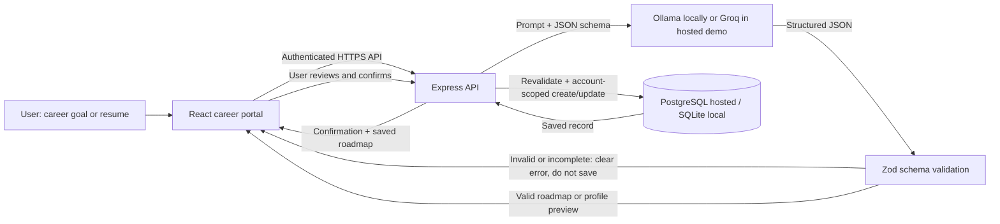

# TalentVerse — CSB312 Generative AI Foundations Mini Project 2

## Project title and objective

**TalentVerse: AI Career Roadmap and Skills Planning Portal.** TalentVerse turns a user's career goal or resume into structured career guidance that can be reviewed, saved to a private account, and updated as the user makes progress. The roadmap builder accepts either a written goal or a resume draft, then tailors milestones to the user's career stage and weekly study time.

## Problem statement

Students and early-career professionals often have unstructured career goals and resumes but no practical sequence of skills and actions. TalentVerse extracts profile information from a resume and converts a career goal into a time-bounded, editable roadmap with skill gaps and milestones.

## Selected automation

**Convert a career goal into a skill-gap map and milestone-based learning plan.** The user supplies a goal, optional target role, existing skills, and preparation timeline. The AI returns structured fields. TalentVerse validates the output, shows a preview, and saves only after the user approves it.

## Workflow and architecture



### Technology stack

- Frontend: React, TypeScript, Vite, accessible form controls.
- Backend: Node.js, Express, TypeScript, JSON API.
- AI: Ollama with `llama3:latest` for local use; Groq with `llama-3.3-70b-versatile` for hosted use.
- Validation: Zod validates user input, AI roadmap output, and resume extraction output.
- Database: SQLite for local development; PostgreSQL for hosted deployment.
- Authentication: bcrypt password hashes and opaque, hashed, HttpOnly session tokens.
- Resume comparison: an authenticated, rate-limited upload compares a resume with a supplied vacancy description. Zod checks the 0–100 score and evidence lists; the estimate is informational, not a promise of employer screening outcomes.
- Career notes: account-owned notes support create, update, list, and delete operations in SQLite/PostgreSQL.
- Courses: role-linked learning links are shown beside skill priorities.
- Roadmap reliability: the generated response is normalized and validated; if AI is unavailable or malformed, the application supplies a deterministic, role-aware four-stage plan that remains editable and approval-gated.

## Schema and sample output

The career-plan contract is implemented in `backend/src/schema.ts`. Top-level fields are `target_role` (string), `career_goal` (string), `timeline_months` (integer, 1–24), `current_skills` (string array), `missing_information` (string array), `skill_gaps` (array of `{ name, priority, reason }`), and `milestones` (array of `{ title, description, month, priority, tasks, status }`). Priorities are enumerated as high/medium/low. Status is enumerated as not_started/in_progress/completed. The validator rejects missing fields, invalid enum values, out-of-range data, and milestones beyond the selected timeline.

```json
{
  "target_role": "Frontend Developer",
  "career_goal": "Become a job-ready frontend developer with a portfolio.",
  "timeline_months": 6,
  "current_skills": ["HTML", "CSS"],
  "missing_information": ["Weekly study time"],
  "skill_gaps": [
    { "name": "JavaScript", "priority": "high", "reason": "Build interactive browser experiences." }
  ],
  "milestones": [
    {
      "title": "Learn JavaScript",
      "description": "Practice language fundamentals with small browser exercises.",
      "month": 2,
      "priority": "high",
      "tasks": ["Build a calculator"],
      "status": "not_started"
    },
    {
      "title": "Publish a portfolio",
      "description": "Create and deploy projects that demonstrate frontend skills.",
      "month": 6,
      "priority": "medium",
      "tasks": ["Ship a portfolio site"],
      "status": "not_started"
    }
  ]
}
```

## Database design and operations

- `users`: unique email and password hash; account identity is the ownership key.
- `sessions`: SHA-256 hash of an opaque random token, owner, and expiry. The raw token exists only in the HttpOnly browser cookie.
- `profiles`: one JSON profile per account, including extracted resume fields; the uploaded file itself is not persisted.
- `career_plans`: validated goal, timeline, skills, missing information, skill gaps, milestones, owner, and timestamps.
- `career_notes`: user-owned learning and career notes with created/updated timestamps.
- `password_resets`: a single SHA-256 token hash per user with an expiration; reset consumes the token and invalidates active sessions.

The roadmap preview endpoint does not write to the database. After confirmation, `POST /api/career-plans` validates the preview again and inserts it with the authenticated user's ID. `PATCH /api/career-plans/:id/milestones/:index` updates a milestone only when the record belongs to the signed-in user. Resume extraction validates the result and returns a draft; the user reviews it and can apply its role and skills to the roadmap builder or choose **Save to profile**. Settings save career stage and weekly study hours through the validated profile API. Database access is parameterized and account-scoped.

## Validation and test evidence

The saved roadmap has timeline, milestone-list, and skill-gap views, progress status controls for saved milestones, a Markdown download, and a print-to-PDF action. Automated checks cover valid and invalid roadmap schemas, missing fields, timeline violations, underspecified goals, invalid career stages, incomplete resume extraction, reset-password input validation, and a SQLite persistence workflow that saves a validated roadmap and rejects an invalid one before it can be stored. Run `npm test` for these checks and `npm run build` for frontend/backend type checks and the production Vite build. Before submission, capture screenshots of the generated preview, saved roadmap, and validation/error case from the deployed site.

The local browser presents the forgot-password entry point. The automated SQLite workflow verifies that valid career-plan data is persisted and invalid schema output cannot be stored. Before submission, capture the deployed AI-generated roadmap preview, approved saved roadmap, milestone update, and a validation/error case. Do not describe these as live evidence until the hosted flow has been run.

## Known limitations and future improvements

- Role recommendations are curated role matches with job-board search links; they are not a live job-vacancy feed.
- The hosted demo needs a Groq API key. Resume text is sent to Groq only after the user confirms the consent checkbox. Local Ollama is preferred when available.
- Hosted password-reset email requires a Resend API key, verified sender address, and the deployed application base URL. Email verification, account export/deletion, backup/restore rehearsal, operational monitoring, and an independently reviewed privacy policy are future production improvements.
- Role recommendations use a curated catalog and current job-board searches; they are not a live vacancy feed.

## Deployment URL

**Not deployed yet.** Deployment requires a Git repository connected to a hosting account, a managed PostgreSQL database, and hosted AI/email secrets. After publishing with the included Render Blueprint and setting those secrets, place the verified public frontend URL here. The service is a single-origin app: Express serves the Vite build and API from the same HTTPS domain.
